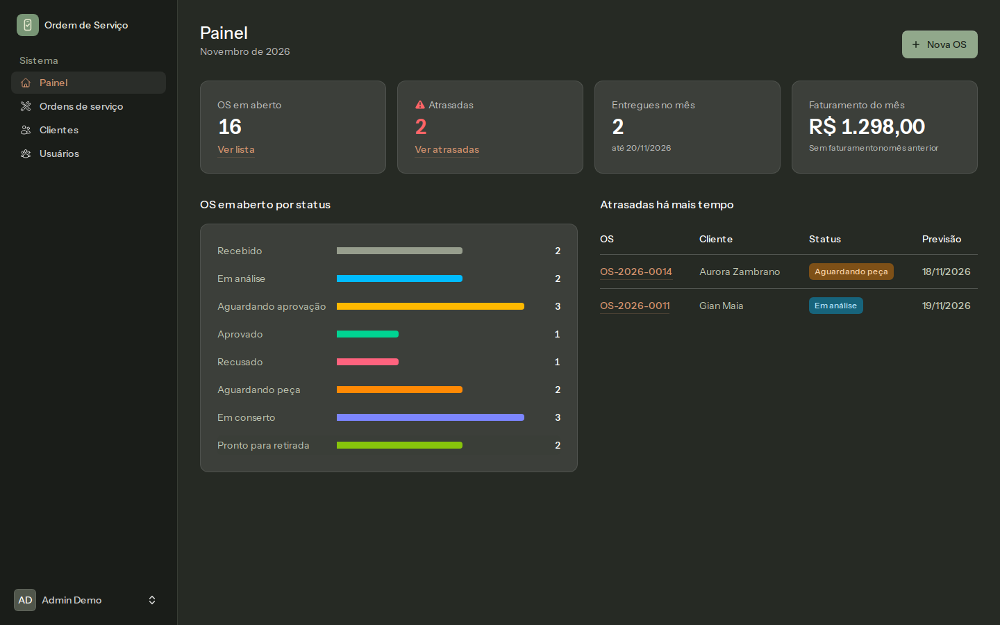
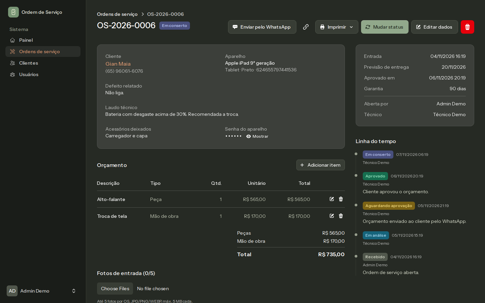
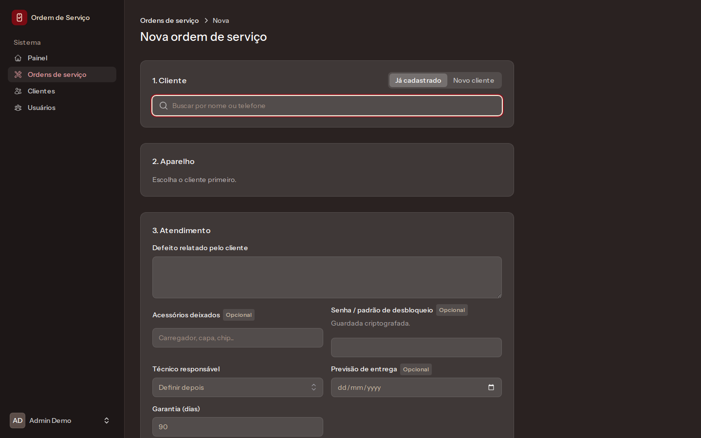
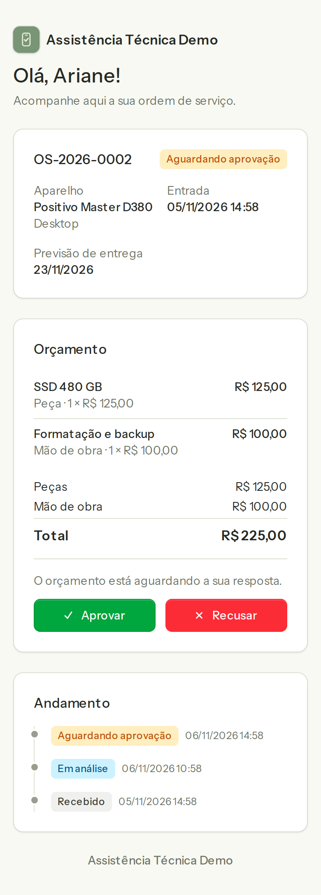
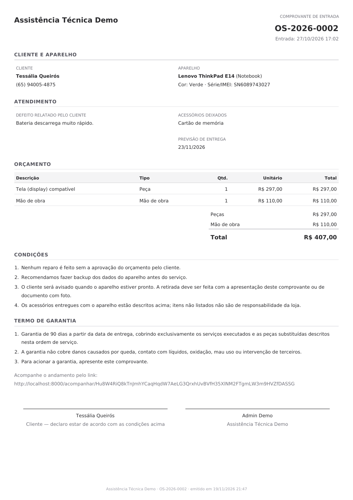
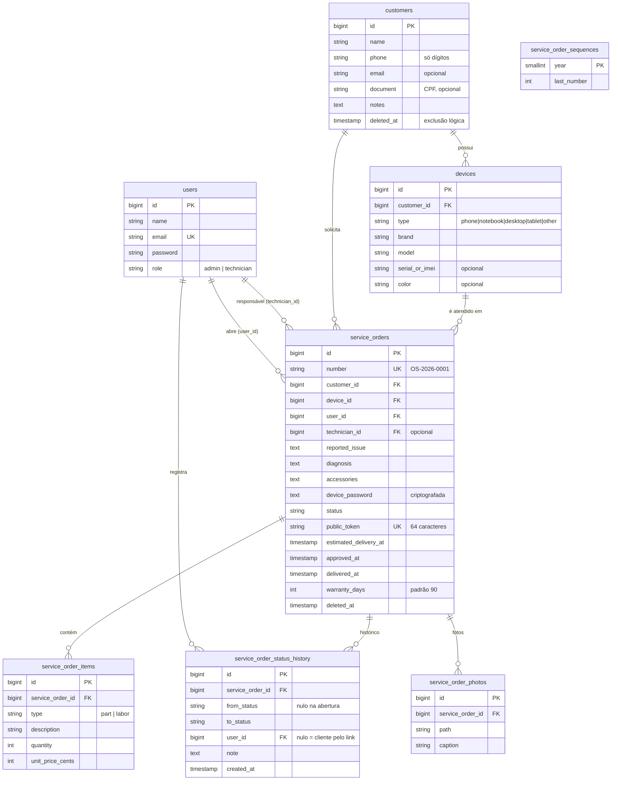

# Sistema de Ordens de Serviço para Assistência Técnica

[](https://github.com/Netero-mac/ordem-servico/actions/workflows/ci.yml)


Aplicação web para controlar o conserto de celulares e computadores do balcão até a entrega: abertura da OS, orçamento, aprovação pelo cliente, acompanhamento pelo WhatsApp, comprovantes em PDF e indicadores do mês.

**🔗 Demonstração:** https://SEU-APP.onrender.com — entre com `admin@example.com` / `password` (administrador) ou `tecnico@example.com` / `password` (técnico).

> A demonstração usa o plano gratuito da Render: o primeiro acesso pode levar até um minuto enquanto o servidor "acorda". Todos os dados são fictícios.

---

## O problema

Em assistências técnicas pequenas, o controle costuma ser feito em caderno, planilha ou conversa de WhatsApp. Isso gera problemas conhecidos:

- **"Meu celular já está pronto?"**: o cliente liga várias vezes porque não sabe em que pé está o conserto.
- **Orçamento aprovado "de boca"**: depois ninguém lembra o valor combinado nem quando o cliente autorizou.
- **Aparelho esquecido na prateleira**: sem prazo visível, os atrasos só aparecem quando o cliente reclama.
- **Senha do aparelho anotada em papel** junto com o aparelho.
- **Fim do mês sem números**: quanto entrou, quantos aparelhos foram entregues, o que está parado.

## Como o sistema resolve

| Problema | Solução |
|---|---|
| Cliente sem informação | Link público de acompanhamento enviado pelo WhatsApp com um clique, mostrando status, linha do tempo e orçamento |
| Aprovação informal | O cliente **aprova ou recusa o orçamento pelo próprio link**; a decisão fica registrada no histórico com data e hora |
| Atrasos invisíveis | OS com previsão vencida aparecem em vermelho na lista e no painel |
| Senha em papel | Senha guardada **criptografada** no banco e exibida só sob demanda |
| Sem números | Painel com OS por status, atrasadas, entregues no mês e faturamento |

## Funcionalidades

- **Clientes e aparelhos**: cadastro com busca por nome ou telefone (com ou sem máscara), validação de CPF e histórico de OS de cada aparelho.
- **Abertura de OS em uma tela só**: escolhe ou cadastra o cliente e o aparelho na hora; tudo é gravado numa única transação.
- **Fluxo de status com regras**: as transições permitidas ficam no próprio Enum (`canTransitionTo`) e toda mudança gera uma linha no histórico.

  ```
  Recebido → Em análise → Aguardando aprovação → Aprovado → (Aguardando peça ⇄) Em conserto → Pronto → Entregue
                                               ↘ Recusado → Pronto (devolução sem reparo)
  Cancelado: a partir de qualquer etapa antes do conserto
  ```
- **Orçamento** com peças e mão de obra, valores em centavos e bloqueio depois da decisão do cliente (só o admin altera).
- **Fotos de entrada** (até 5, só imagens, máx. 5 MB) em disco privado, servidas apenas para usuários logados.
- **Listagem de OS** com filtros por status, técnico, período e atrasadas.
- **Página pública do cliente** (`/acompanhar/{token}`) com token de 64 caracteres, rate limiting e sem nenhum dado sensível.
- **Botão "Enviar pelo WhatsApp"** com mensagem pronta conforme o status.
- **PDFs**: comprovante de entrada (condições, termo de garantia, assinaturas) e comprovante de entrega (serviço, valores e validade da garantia).
- **Painel** com indicadores do mês.
- **Usuários e permissões**: administrador e técnico. Técnico trabalha nas OS, mas **não exclui nada**.
- Autenticação com **2FA** opcional (Fortify).

## Capturas de tela

| Painel | Ordem de serviço |
|---|---|
|  |  |

| Nova OS | Página do cliente (celular) |
|---|---|
|  |  |

| Comprovante de entrada (PDF) |
|---|
|  |

## Stack

| Camada | Tecnologia |
|---|---|
| Back-end | PHP 8.3, Laravel 13 |
| Interface | Blade, Livewire 4, Flux UI, Tailwind CSS 4 |
| Autenticação | Laravel Fortify (Livewire Starter Kit), com 2FA |
| Banco | SQLite (desenvolvimento), PostgreSQL (produção) |
| PDF | barryvdh/laravel-dompdf |
| Testes | Pest 4 |
| Qualidade | Laravel Pint, Larastan (nível 7), GitHub Actions |
| Deploy | Docker (serversideup/php), Render |

## Arquitetura e decisões

- **Regra de negócio fora das telas**: casos de uso em `app/Actions` (`OpenServiceOrder`, `ChangeServiceOrderStatus`, `RecordCustomerDecision`...). Os componentes Livewire só coordenam.
- **Um único caminho para mudar status**: `ChangeServiceOrderStatus` trava a OS no banco (`lockForUpdate`), valida a transição pelo Enum e grava o histórico. Se o cliente aprovar pelo link no mesmo instante em que o técnico cancela, a segunda ação é recusada.
- **Autorização em Policies**, verificada tanto na tela (o botão nem aparece) quanto na ação (retorna 403). Há um teste de matriz em `tests/Feature/Authorization`.
- **Validação**: Form objects do Livewire (`app/Livewire/Forms`) nas telas e Form Request (`CustomerDecisionRequest`) na rota HTTP pública.
- **Dinheiro em centavos** (`integer`) e conversão no formato brasileiro em `App\Support\Money`.
- **Datas em UTC no banco**, exibidas em `America/Cuiaba`. Os filtros por período e o "mês" do faturamento respeitam o fuso da loja.
- **Número da OS** (`OS-2026-0001`) gerado por um contador por ano com incremento atômico: duas OS abertas ao mesmo tempo nunca recebem o mesmo número.
- **Faturamento** soma apenas OS entregues **com orçamento aprovado**; aparelhos devolvidos sem conserto não contam.
- **Página pública** monta um array só com os campos permitidos, em vez de enviar o model para a view, para que dados internos não vazem.

## Banco de dados



## Como rodar localmente

Requisitos: PHP 8.3+ (extensões `pdo_sqlite`, `mbstring`, `xml`, `zip`, `gd`), Composer e Node 20.19+.

```bash
git clone https://github.com/Netero-mac/ordem-servico.git
cd ordem-servico

composer setup                    # instala dependências, cria o .env, gera a chave, migra e compila os assets
php artisan db:seed               # dados fictícios: 2 usuários, 10 clientes e 20 OS
composer run dev                  # servidor, fila, logs e Vite juntos
```

Acesse http://localhost:8000 e entre com `admin@example.com` / `password`.

## Como rodar os testes

```bash
php artisan test                  # suíte completa (Pest)
composer test                     # Pint + Larastan + Pest, igual ao CI
composer lint                     # corrige o estilo com o Pint
```

O CI roda a suíte contra **SQLite e PostgreSQL** e publica o relatório de cobertura (PCOV). O que os testes cobrem:

- transições de status (todos os 100 pares possíveis) e histórico;
- numeração das OS, criptografia da senha e token público;
- abertura de OS, orçamento, fotos, filtros e atrasadas;
- página pública: o que **não** pode aparecer, token inválido, rate limiting e aprovação/recusa;
- PDFs, painel (incluindo virada de mês no fuso de Cuiabá) e matriz de autorização por papel.

## Deploy na Render

O repositório tem um `Dockerfile` e um Blueprint (`render.yaml`) que criam o banco PostgreSQL e o serviço web.

1. Faça um fork e, na Render, escolha **New → Blueprint** apontando para o repositório.
2. Preencha as variáveis pedidas (`APP_KEY`, `APP_URL`, dados da loja). Gere a chave com `php artisan key:generate --show`.
3. A cada deploy, o container roda automaticamente `migrate --force`, os caches do Laravel e o comando `app:bootstrap`.

### Variáveis de ambiente

| Variável | Para quê |
|---|---|
| `APP_KEY` | Chave de criptografia (sessões e senha dos aparelhos). **Nunca troque depois de ter dados**, ou as senhas guardadas ficam ilegíveis. |
| `APP_URL` | URL pública (usada nos links do WhatsApp e dos PDFs) |
| `DB_URL` | Conexão do PostgreSQL (preenchida pelo Blueprint) |
| `SHOP_NAME`, `SHOP_PHONE`, `SHOP_ADDRESS`, `SHOP_DOCUMENT` | Dados da loja nos PDFs, na página do cliente e no WhatsApp |
| `APP_DISPLAY_TIMEZONE` | Fuso de exibição (padrão `America/Cuiaba`) |
| `SEED_DEMO_DATA` | `true` carrega os dados fictícios num banco vazio (demonstração) |
| `INITIAL_ADMIN_EMAIL`, `INITIAL_ADMIN_PASSWORD`, `INITIAL_ADMIN_NAME` | Criam o primeiro administrador num banco vazio (uso real). Remova a senha depois do primeiro deploy. |
| `PHOTOS_DISK` | Disco das fotos das OS (padrão `local`) |
| `MAIL_*` | Envio de e-mail para "Esqueci a senha" (padrão `log`, não envia) |

### Limitações do plano gratuito

- **Fotos**: o disco do container é apagado a cada deploy. Para uso real, configure um storage compatível com S3 (ex.: Cloudflare R2) em `PHOTOS_DISK`.
- **Banco**: o PostgreSQL gratuito da Render expira após 30 dias e não tem backup. Para uso real, use um plano pago ou outro provedor.
- **Hibernação**: o serviço dorme sem acessos e demora para acordar.

## Estrutura

```
app/
├── Actions/          # casos de uso (abrir OS, mudar status, decisão do cliente, fotos...)
├── Enums/            # ServiceOrderStatus (transições), UserRole, DeviceType, ItemType
├── Http/             # controllers da página pública, PDFs e fotos; Form Request
├── Livewire/         # telas (Clientes, OS, Painel, Usuários) e Form objects
├── Models/
├── Policies/         # quem pode o quê
├── Services/         # métricas do painel, link do WhatsApp
└── Support/          # Money, Phone, Cpf, Dates
config/shop.php       # dados da loja e textos dos termos
resources/views/pdf/  # comprovantes
tests/                # Pest: Unit e Feature
```

## Licença

MIT.
